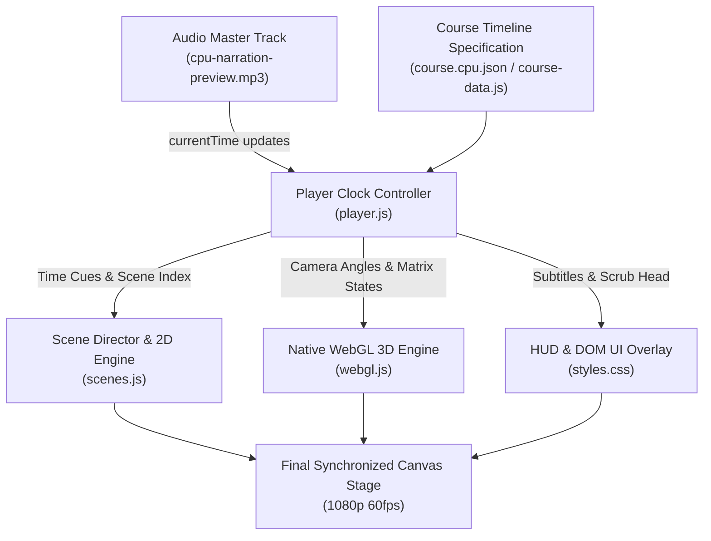

# Docs / Architecture.md — Technical Architecture & Audio-Visual Sync

**Package:** ZCLE Studio (`26.10.24.00/Standard`)

---

## 1. High-Level Architecture Diagram

---

## 2. Core Subsystems

### 2.1 The Master Clock (`player.js`)
- Playback clock browser ke standard `HTMLAudioElement` par based hai.
- Har animation frame `requestAnimationFrame` loop se nikalta hai, jahan:
  `currentTime = audioEl.currentTime`
  `localSceneTime = currentTime - currentScene.start`
- Is tarah agar CPU load ya dropped frames bhi aate hain, tab bhi visuals drift nahi karte; audio timeline hi authoritative frame position enforce karti hai.

### 2.2 The WebGL Renderer (`webgl.js`)
- Standard WebGL 1.0/2.0 context directly canvas par initialize hota hai.
- Lightweight custom vertex and fragment shaders:
  - Procedural motherboard circuit traces with glowing pulses.
  - Exploded 3D chip layers: Package -> Heat Spreader -> Silicon Die -> ALU & Cache Core blocks.
  - Mouse/touch drag camera rotation or programmatic cinematic orbital pans.

### 2.3 The Scene Director (`scenes.js`)
- Deterministic stateless function: `renderScene(sceneId, localMs)`.
- Given a specific millisecond timestamp, ye function exactly vahi geometry, text cards aur highlight state paint karta hai. Seeking back and forth is 100% stable.

