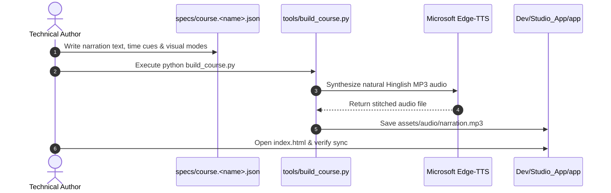

# Docs / Workflows.md — Authoring & Generation Workflows

**Package:** ZCLE Studio (`26.10.24.00/Standard`)

---

## 1. Course Authoring Workflow

Naya technical lesson add karne ka standard flow:



---

## 2. Audio Generation Commands

Python virtual environment ya global environment mein required packages install karein:
```bash
pip install edge-tts pydub
```

Audio build script run karein:
```bash
cd Dev/Studio_App/tools
python build_course.py
```
Output MP3 automatically `Dev/Studio_App/assets/audio/cpu-narration-preview.mp3` aur central `Assets/audio/` mein generate ho jayegi.

---

## 3. Validation Workflow

JSON timeline schema compliance check karne ke liye:
```bash
pip install jsonschema
python Dev/Studio_App/tests/validate.py
```

